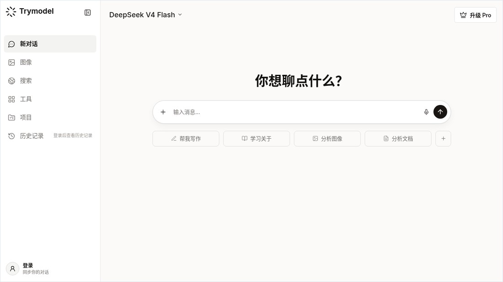
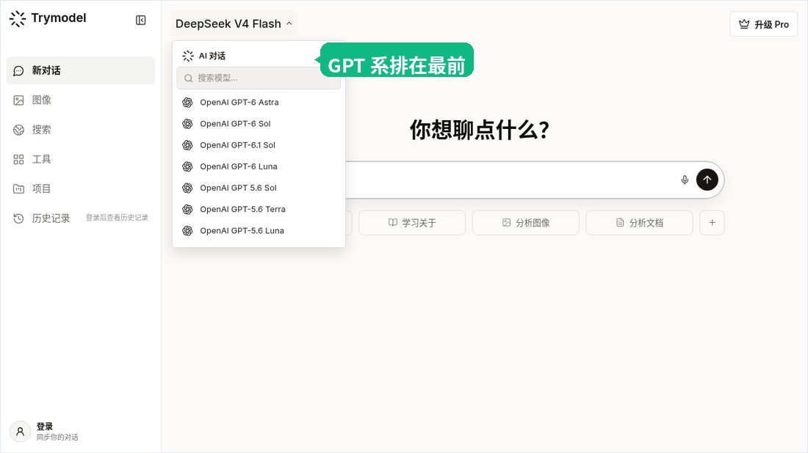
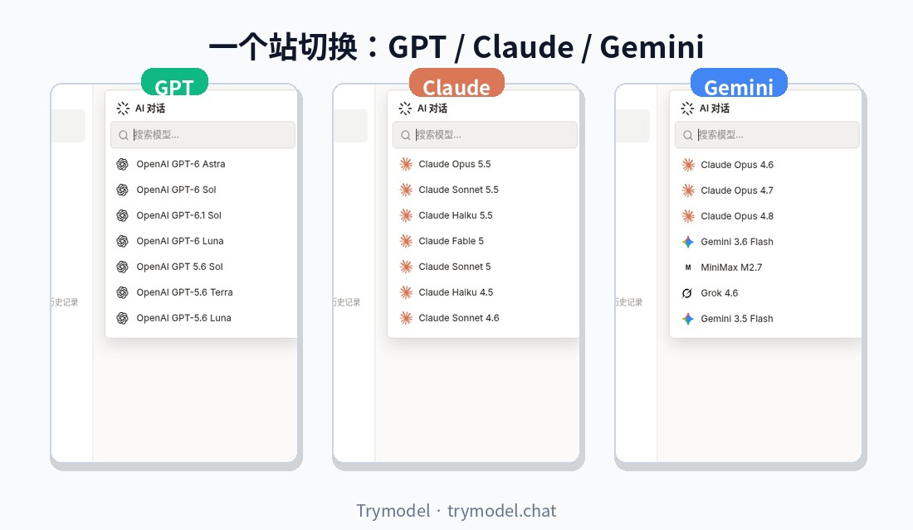

> 在线阅读（GitHub Pages）：https://maynor996.github.io/trymodel-multi-model-trial/

# 在 trymodel.chat 一站试用 Gemini 3.7 Flash、GPT-5.6、GPT Image 2、Claude Fable 5.1 与 DeepSeek / Grok 最新模型

新模型几乎每周都在刷屏：Gemini Flash 连续迭代，GPT-5.6 拆成多档，图片侧又出现 GPT Image 2，Claude、DeepSeek、Grok 也在同步换代。问题不在「听没听说过」，而在**能不能用同一个入口、同一道真实任务，把它们挨个试完**。

[Trymodel](https://trymodel.chat/)（https://trymodel.chat/）把聊天、生图和搜索放在一个工作区：打开站点就能选模型发消息；需要海报或产品图时进图片页；需要对照多家输出时，不必再开一堆官方会员页。下面按家族梳理站内文档与当前可选模型，并说明怎么切换、什么场景选哪一档。文中能力描述以 [trymodel.chat](https://trymodel.chat/) 博客与站内模型列表为准；列表会随上游更新，以你打开时下拉里的名称为最终依据。

## Trymodel 是什么、怎么免费上手

根据站点说明（[llms.txt](https://trymodel.chat/llms.txt)），Trymodel 的定位是：在一个平台上与多家 AI 模型聊天、创作和搜索。主要入口包括：

- 聊天：https://trymodel.chat/chat（多模型对话、历史、切换）
- 生图：https://trymodel.chat/image（提示词、比例、模型）
- 定价：https://trymodel.chat/pricing（订阅与额度；页面写明可访问 25+ 高端模型，对话中途可切换）
- 博客：https://trymodel.chat/blog（发布说明与用法指南）

**免费路径（可先试再决定是否升级）：**

1. 直接打开 https://trymodel.chat/ ，未登录也可进入对话界面。
2. 站点默认聊天模型会落到 **DeepSeek V4 Flash** 一类试用友好线路（以页面顶栏当前显示为准）。
3. 在模型下拉里搜索 `Claude`、`Gemini`、`GPT`、`DeepSeek`、`Grok`，先挑 Flash / Haiku / Luna 等更轻的一档做同一道题。
4. 需要连续对话历史、更高档模型或优先速度时，再登录；付费档见定价页（周/月/年一次性购买说明以页面为准）。
5. 官方也整理了免费对比工作流：[Try AI Model Free](https://trymodel.chat/blog/try-ai-model-free)——强调用真实任务、同一提示词、再追问一轮，而不是只看第一句「听起来很自信」的回答。

不要上传密码、API Key、未脱敏客户资料或未公开合同到任何聊天服务。

---

## Gemini 3.7 Flash：面向 Coding 与 Agent 的 Flash 线

站内中文专题：[Gemini 3.7 Flash 正式发布，谷歌真的急了](https://trymodel.chat/blog/gemini-3-7-flash-release)。文章整理了官方对 **Gemini 3.7 Flash** 的定位：面向 Coding、Agent 与企业自动化工作流；相对上一代 Flash，软件工程与多步工具调用相关成绩有明显抬升，同时强调速度与调用成本仍是 Flash 的核心卖点。文末体验入口指向 https://trymodel.chat/ 。

**在 Trymodel 里怎么找：**

1. 打开 https://trymodel.chat/chat
2. 点击输入区上方的模型名称，打开下拉
3. 搜索 `Gemini` 或 `Flash`

说明：博客专题写的是 **Gemini 3.7 Flash**；当前聊天模型列表里，Google 线还会出现 **Gemini 3.5 Flash / 3.6 Flash / 3.8 Flash** 以及 **Gemini 3 Pro / 3.1 Pro** 等展示名（以你当下拉列表为准）。做 Coding、Agent 或多步工具调用时，优先选最新的 Flash；长文档、多模态对照可再试 Pro 档。

适合：高频改代码、网页开发草稿、需要反复 tool call 的自动化流程，以及对延迟和成本敏感的日常任务。

---

## GPT-5.6：Sol / Terra / Luna，按任务选档

站内指南：[GPT-5.6 怎么用？从模型选择到高质量对话的一份实用指南](https://trymodel.chat/blog/gpt-5-6-ai-chat-guide)。另一篇产品向解读 [The Best AI Model No Longer Exists](https://trymodel.chat/blog/best-ai-model-no-longer-exists) 说明：OpenAI 将 **GPT-5.6** 拆成多档（文中提到 Sol / Terra / Luna），「一个旗舰包办一切」的用法正在过时。

当前 Trymodel 聊天列表中可见（展示名以列表为准）：

| 展示名 | 大致用法 |
| --- | --- |
| **OpenAI GPT-5.6 Terra** | 日常均衡：写作、分析、一般编程 |
| **OpenAI GPT 5.6 Sol** | 更重推理、难题与复杂编码时可对比 |
| **OpenAI GPT-5.6 Luna** | 更偏速度与高频短任务 |

同页还可搜到 GPT-5.5 及更早 GPT 线，方便对照。选模型时建议：复杂分析写清背景与验收标准；改代码贴最小复现与完整报错；处理文件时要求引用页码或单元格——指南中的「角色 / 目标 / 背景 / 约束 / 验收」五段式提示词，在 https://trymodel.chat/chat 里直接复用即可。

适合：结构化写作、调试、上传 PDF/表格后的引用式问答，以及需要在同一对话里连续追问的工作流。

---

## GPT Image 2：比例、提示词与小步迭代

生图专题：[GPT Image 2 怎么生成图片？比例、提示词和迭代方法一次讲清](https://trymodel.chat/blog/ai-image-gpt-image-2-guide)。入口：https://trymodel.chat/image ，在图片模型中选择 **`gpt-image-2` / GPT Image 2**。

实用流程（与站内指南一致）：

1. **先定比例再写画面**：如 1:1 头像图标、3:2 横向配图、2:3 海报竖图。
2. **四层提示词**：主体 → 场景 → 视觉（光、材质、镜头）→ 约束（文字位置、禁忌元素）。
3. **画面文字尽量短**，并写明位置与对比度；长文案更稳妥的做法是先出干净底图再后期叠字。
4. **一次只改一个变量**（主体 → 构图 → 灯光材质 → 文字细节），方便复用成功提示词。

同页图片模型目录中，除 **GPT Image 2** 外，还可看到 Nano Banana / Nano Banana Pro、Seedream、Grok Imagine Image 等选项（以图片页当前列表为准）。像素尺寸与导出格式以页面实际返回为准，不要仅因提示词写了「4K」就当作原生 4K 交付。

适合：海报、产品图、封面、需要可读短文案的包装示意。

---

## Claude：Fable 5.1 与 Opus · Sonnet · Haiku 5.5

在模型下拉搜索 `Claude`，当前可见主推档包括：

| 展示名 | 定位（按站内列表与常见用法） |
| --- | --- |
| **Claude Fable 5.1** | 最重推理、长链路 Agent；难题、长跑 coding / 研究 |
| **Claude Opus 5.5** | 主力 Agent 编码与知识工作 |
| **Claude Sonnet 5.5** | 速度与智能的平衡，日常问答与改代码 |
| **Claude Haiku 5.5** | 更快更省的小模型，分类、抽取、高频短对话 |

列表里通常还保留 Fable 5、Sonnet 5、Haiku 4.5 以及若干 Opus 4.x / 5 等对照款。写作与细腻改稿、仓库级改代码时，很多人会先试 Sonnet 5.5；仍然不够再上 Opus 5.5 或 Fable 5.1。

适合：长文改写、代码审查、多文件重构计划、需要稳定指令遵循的任务。

---

## DeepSeek：V4.1 Flash 与 V4 Pro

站内 Pro 发布说明：[DeepSeek V4 Pro Released](https://trymodel.chat/blog/deepseek-v4-pro-release)（模型 ID `deepseek-v4-pro` 等细节以该文与上游文档为准）。聊天下拉搜索 `DeepSeek` 时，当前可见：

| 展示名 | 说明 |
| --- | --- |
| **DeepSeek V4.1 Flash** | 新架构小旗舰向：更快、更省，适合高频与多模态向试用 |
| **DeepSeek V4 Pro** | 更重推理、长上下文与复杂编码时可对比 |
| **DeepSeek V4 Flash** | 试用友好；站点默认聊天模型常落到这一档 |

博客还为 V4 Pro 准备了大量场景工作流（编程、代码审查、长文档、联网研究等），可从 https://trymodel.chat/blog 按标题检索。性价比路线：先 V4.1 Flash / V4 Flash，难任务再开 V4 Pro 对照。

适合：中文问答、推理与编程草稿、预算敏感的重复调用。

---

## Grok 4.7（及 4.6 长任务线）

站内发布摘要：[Grok 4.6 Is Here](https://trymodel.chat/blog/grok-4-6-release)，强调长跑 Agent、多步交互与视觉向能力。当前聊天列表中，**Grok 4.7** 排在 Grok 线前列，并保留 **Grok 4.6 / 4.5 / 4** 对照。

用法建议：

1. 打开 https://trymodel.chat/chat ，搜索 `Grok`，优先选 **Grok 4.7**。
2. 用「先计划、再分步改、再验收」的长任务检验，而不是只问一句话。
3. 需要新资料时，可配合 https://trymodel.chat/search 收集来源，再回聊天综合（重要事实仍应回原文核对）。

适合：多文件原型、需要多轮修正的研究与内容生产、偏实时与口语化的问答。

---

## 在 trymodel.chat 如何切换模型

1. 打开 https://trymodel.chat/ 或 https://trymodel.chat/chat  
2. 点击顶栏 / 输入框上方的**当前模型名**（例如 DeepSeek V4 Flash）  
3. 在搜索框输入关键词：`Gemini`、`GPT`、`5.6`、`Claude`、`Fable`、`DeepSeek`、`V4.1`、`Grok`、`4.7`  
4. 点选目标模型后直接发同一道题；需要生图则改走 https://trymodel.chat/image 并选择 **GPT Image 2**  
5. 若列表看起来偏旧：硬刷新页面；站点会缓存模型目录（本地键名含 `trymodel-model-catalog`），刷新后重新打开下拉即可  
6. 部分高阶型号可能需登录或 Pro（定价页：https://trymodel.chat/pricing）；免费试用可先用 Flash / Haiku / Luna / 默认 DeepSeek V4 Flash  

同一对话里切换模型、用同一提示词对比，比纠结「绝对第一」更有用——这也是多模型工作区存在的理由。

---

## 什么时候选哪个（一句话对照）

| 你的目标 | 可优先尝试 |
| --- | --- |
| Coding / Agent / 高频自动化 | Gemini Flash 最新档（列表中的 3.x Flash）、Claude Sonnet 5.5 |
| 最重推理、长链路 | Claude Fable 5.1，其次 Claude Opus 5.5；GPT-5.6 Sol 可对照 |
| 日常写作与均衡问答 | GPT-5.6 Terra、Claude Sonnet 5.5 |
| 便宜高频、先随便聊 | DeepSeek V4 Flash / V4.1 Flash、Claude Haiku 5.5、GPT-5.6 Luna |
| 国产开源向、性价比 | DeepSeek V4.1 Flash → 难任务再比 V4 Pro |
| 长任务把事做完 | Grok 4.7（对照 Grok 4.6） |
| 海报 / 产品图 / 可读短文案 | https://trymodel.chat/image 选 **GPT Image 2** |

建议：固定一道真实任务（一封邮件、一段报错、一页笔记），对 2～3 个模型各跑一遍，再追问同一处弱点，用「准确度 + 返工时间」打分，而不是只看文笔。

---

## 相对上一稿：站内还出现的更新模型名

相对 10 月 21 日侧重 Claude / DeepSeek / Grok 的草稿，本次从站内 **GET 模型列表** 额外核对到、且值得写进选题的更新展示名包括（聊天侧，抽样）：

- **OpenAI GPT-6 Astra / Sol / Luna**、**OpenAI GPT-6.1 Sol**
- **OpenAI GPT-5.6 Terra / Sol / Luna**（以及同族 GPT 5.5 等）
- **Gemini 3.8 Flash**、**Gemini 3.6 Flash**、**Gemini 3.5 Flash**、**Gemini 3.1 Pro**、**Gemini 3 Pro**
- **Qwen 3.8 Max**、**Qwen 3.7 Max**
- **Kimi K3**、**Kimi K2.7 Code**
- **GLM 5.3 / 5.2 / 5.1**
- **MiniMax-M3**、**MiniMax M2.7**
- **Llama 4**

图片侧目录中除 **GPT Image 2** 外，还有 Nano Banana / Nano Banana Pro、Seedream 4.5 / 5.0 Pro、Grok Imagine Image 等。具体是否对你的账号开放、是否计入 Pro，以页面实时列表与定价说明为准。

> 备注：站内博客专题标题使用 **Gemini 3.7 Flash**；若下拉里暂未出现完全同名条目，请搜索 `Gemini` + `Flash`，选用当前列表中的最新 Flash，并以页面显示名为准。

---

## 写在最后

模型名会变，工作流可以固定：**一个真实任务 → 同一提示词 → 两三个模型对照 → 再追问一轮**。把入口收拢到 [trymodel.chat](https://trymodel.chat/)，切换成本最低。

现在就可以打开：

👉 **https://trymodel.chat/**

在下拉里搜一遍 `Gemini`、`GPT-5.6`、`Fable`、`V4.1`、`Grok 4.7`，再到 https://trymodel.chat/image 试一次 **GPT Image 2**。用你自己的工作题测一轮，比任何排行榜都准。
